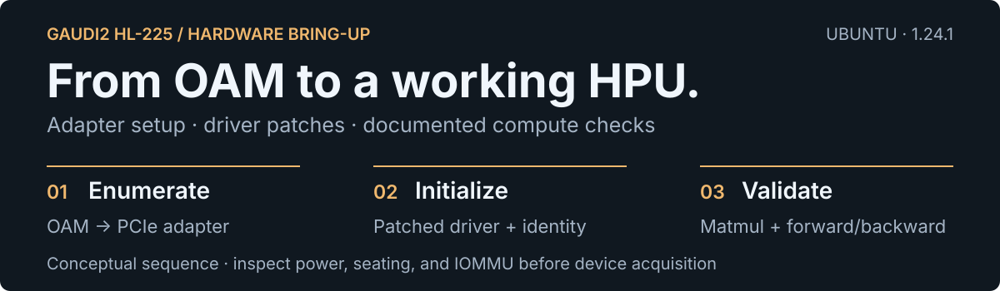
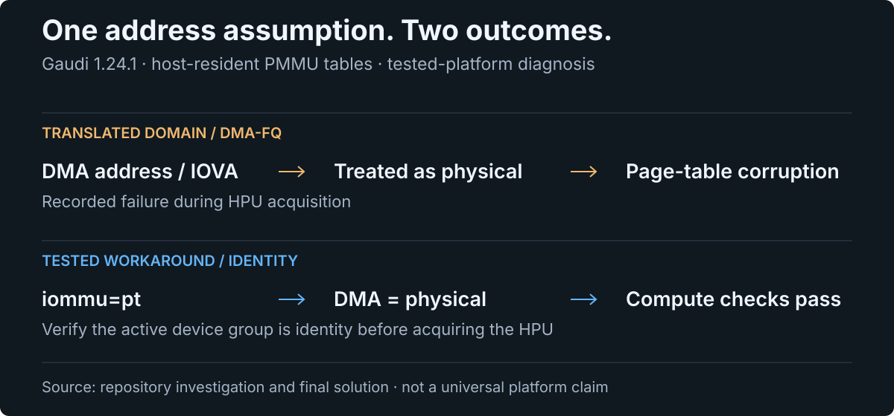

<div align="center">

# Gaudi2 Single-Card Driver Guide

**Bring an Intel Gaudi2 OAM module online through a PCIe adapter on Ubuntu.**

[](#validated-setup)
[](#validated-setup)
[](#validated-setup)

[Quick start](#quick-start) · [Five-part fix](#the-five-part-fix) · [Troubleshooting](#troubleshooting) · [Documentation](#documentation) · [Limitations](#limitations)

</div>

<p align="center">
  
</p>

A practical record of **hardware installation, driver patches, PyTorch setup, and kernel-panic diagnosis** for a Gaudi2 HL-225 on a platform outside Intel's supported server configurations. The documented setup uses an OAM-to-PCIe adapter, including a fix for a Gaudi 1.24.1 device-acquisition panic.

> [!WARNING]
> **The tested Gaudi 1.24.1 setup requires `iommu=pt` and an `identity` IOMMU domain.** The recorded translated-domain configuration panics when acquiring the HPU. Read [Before installation](#before-installation) and the [complete solution](./完整解决方案.md) before running the installer.

## Validated setup

Two host configurations have been checked. Their software versions and validation scope are listed separately.

### GIGABYTE MU70-SU0-NV-XX / Xeon E5-2696 v3

The project's original final solution records successful computation and reboot verification on this platform.

| Component / check | Recorded result |
|:---|:---|
| Host | Ubuntu 24.04.4, kernel `6.8.0-136-generic`; PCIe Gen3 x8 on the tested platform |
| Gaudi software | **`1.24.1-482`** |
| Intel Gaudi PyTorch | `2.11.0a0+git009b5f6` |
| Habana Torch Plugin / Python | `1.24.1.482` / Python 3.12 |
| Device acquisition | HPU available, device name `GAUDI2` |
| Memory check | Original tool output reports **101.6 GB**; the card is documented as a 96 GB HBM2e model |
| Compute | **4,096×4,096 matmul**, ReLU, and Softmax passed |
| Training path | Forward and backward propagation passed |
| Reboot | Configuration remained functional after restart |

The [final solution](./完整解决方案.md) supersedes interim failure conclusions in the historical investigation logs.

### Supermicro H13SSL-N / AMD engineering sample

Hardware and driver state checked on **2026-11-06** using DMI, `lscpu`,
`lspci`, DKMS and `hl-smi`. The CPU identifies itself as an engineering sample;
a retail CPU model has not been inferred from its identifier.

| Component / check | Observed result |
|:---|:---|
| Motherboard / BIOS | **Supermicro H13SSL-N**, board revision `1.01`; AMI BIOS `3.8`, dated `2026-01-06` |
| CPU | **AMD Eng Sample: `100-000000897-03`**; one socket, 32 cores / 64 threads |
| System RAM | **96 GB**, four 24 GB DDR5 registered DIMMs, configured at **4800 MT/s**; about 94 GiB visible to Linux |
| Accelerator | One **Gaudi2 HL-225**, PCI ID `1da3:1020` rev 01; `hl-smi` reports **98304 MiB** device memory |
| PCIe link | **Gen4 x16**, negotiated at **16 GT/s x16** |
| Operating system | **Ubuntu 22.04.5 LTS**, x86_64 |
| Kernel | Originally validated on `5.15.0-186-generic`; currently running `5.15.0-202-generic` |
| Gaudi software / loaded driver | **`1.24.2-481`** / `1.24.2-52a555d` |
| Habana PyTorch / plugin / Python | `2.13.0a0+git2469d18` / `1.24.2.481` / Python `3.10.12` |
| IOMMU / module option | `iommu=pt`, device domain **`identity`**; `nic_ports_ext_mask=0` |
| Driver / networking devices | **Operational**, `hl-smi` works; `hbl_0` and all three Habana auxiliary devices present |
| DKMS / headers | Patched modules and headers verified for **both `186` and `202` kernels** |
| Compute after driver recovery | HPU available, one `GAUDI2`; BF16 **4×4 matmul** matched the CPU reference exactly on kernel `202` |
| Earlier application validation | On kernel `186`, a separate ComfyUI HPU adaptation completed Krea2, Qwen-Image-2.1-Turbo and MOSS-Image SFT generation at 512² / 1024²; this does not establish stock ComfyUI compatibility |
| Reboot scope | Reboot into `202` exposed missing DKMS modules; online recovery and checks passed. **A further reboot after the fix has not been tested.** |

This host confirmed that a healthy driver on the running kernel does not prove
that another installed kernel is ready to boot. The installer now checks all
bootable kernel images; see [Kernel updates and reboot readiness](#kernel-updates-and-reboot-readiness).


## Choose your entry point

| Situation | Start here |
|:---|:---|
| First installation | [Quick start](#quick-start), then the [deployment manual](./部署手册.md) |
| Card missing from PCIe | [Hardware diagnostics](#hardware-diagnostics) and [installation / LED notes](./硬件安装与LED诊断.md) |
| `bad SerDes type 65535` | [SerDes diagnosis](#serdes-type-0xffff) |
| Panic while acquiring the HPU | [IOMMU root cause](#why-iommupt-matters) and the [panic investigation](./1.24.1升级与panic排查记录.md) |
| Existing installation needs a health check | `/usr/local/bin/gaudi-check` |

## Before installation

This is a **community adaptation for the hardware combinations above**. The installer changes kernel boot arguments, patches DKMS source, installs software, writes module parameters, and holds selected packages. Arrange console access or a recovery path before changing a host.

| Requirement | What to check | H13SSL-N validation (2026-11-06) |
|:---|:---|:---|
| Hardware | Gaudi2 OAM module and a compatible OAM-to-PCIe adapter | HL-225 enumerated as `1da3:1020` and reached Operational state |
| Slot | A CPU-connected PCIe x16 slot; check the actual negotiated link | **Gen4 x16 / 16 GT/s**, compared with Gen3 x8 on the original GIGABYTE host |
| Power | The documented adapter setup uses **48 V / 54 V auxiliary power**, not an ordinary 12 V PCIe power lead | Supply voltage and adapter wiring were not measured by these software checks |
| Operating system | Ubuntu **22.04 or 24.04** | **22.04.5 LTS**; original platform uses 24.04.4 |
| Access / tools | `sudo`, `gcc`, `make`, `dkms`, `curl`, `gpg`, `dpkg-deb`, `strings`, and the matching kernel headers | Installer preflight passed; headers present for `5.15.0-186` and `5.15.0-202` |
| Bootable kernels | Check every installed `/boot/vmlinuz-*` target, including kernels not yet running | Both kernels have the patched `1.24.2-481` DKMS driver; only checking `uname -r` previously missed `202` |
| IOMMU | `iommu=pt` in the active boot command line; device group type `identity` | Both verified; HPU computation passed with this configuration |
| Module options | `nic_ports_ext_mask=0`; **do not add `card_type=0`** | Active `nic_ports_ext_mask` is **0**; RDMA and auxiliary devices are present |
| Secure Boot | Confirm that the platform accepts the installed kernel modules | **Disabled** on this host; Secure Boot with enrolled signing keys was not tested |
| Python packages | Use the matching Habana runtime in an isolated venv: Python **3.10 for Ubuntu 22.04**, **3.12 for Ubuntu 24.04**. Prevent pip from replacing Habana PyTorch | Python **3.10.12**, Habana torch **2.13.0a0**, plugin **1.24.2.481**; do not replace this torch to resolve unrelated package pins |

Run `sudo ./scripts/install-gaudi2.sh --verify-only --skip-pytorch` after a kernel
update or driver reinstall and before rebooting. It validates the installed
modules for every target kernel; it does not substitute for a real reboot test.

## Quick start

### Install

Run on the target Ubuntu host after reviewing the requirements:

```bash
git clone https://github.com/JChen-318/gaudi2-single-card-driver.git
cd gaudi2-single-card-driver

sudo ./scripts/install-gaudi2.sh
```

The installer checks the environment, verifies/configures `iommu=pt`, installs Gaudi 1.24.2, applies three source patches, rebuilds DKMS, writes module options, installs PyTorch, and runs compute validation. If it adds a boot argument, reboot and rerun the installer to continue.

| Option | Actual scope |
|:---|:---|
| `--skip-pytorch` | Skip PyTorch installation and HPU compute tests; still validate the driver and runtime libraries |
| `--verify-only` | Validate installed drivers for all bootable kernels and runtime health without installation or configuration changes; runs compute checks unless combined with `--skip-pytorch` |
| `--check-iommu` | Check the boot argument and IOMMU domain; exit before later installation stages |

Use `--verify-only --skip-pytorch` for inspection without HPU compute tests.

### Kernel updates and reboot readiness

The installer checks the running kernel and every kernel image present as
`/boot/vmlinuz-*`. It requires their headers before changing driver packages,
builds missing or invalid patched Habana modules for each kernel, and refreshes
each initramfs. Stale `/lib/modules` directories without boot images are ignored.
A healthy running driver does not skip checks for a newly installed kernel.

After a kernel update or driver reinstall, check reboot readiness with:

```bash
sudo ./scripts/install-gaudi2.sh --verify-only --skip-pytorch
```

This checks each target kernel without rebuilding or running HPU compute tests.
Missing DKMS installations, auxiliary modules, Gaudi2 aliases or patch markers
cause a nonzero exit. Install the requested headers and rerun the installer if
this check fails. It does not reboot the host or validate a complete boot cycle.

The DKMS regression tests use temporary files and mock system commands; no root
access, package installation or hardware is required:

```bash
bash tests/test-gaudi-dkms.sh
```

### Check and use the device

```bash
# Inspect the installed setup
/usr/local/bin/gaudi-check

# Run a program with the Habana environment loaded
hpu-run python3 your_script.py
```

Confirm that `iommu=pt` is active and the device's IOMMU domain is `identity` before acquiring the HPU. A successful `hl-smi` or `torch.hpu.is_available()` result alone did not prove safe device acquisition in the recorded failing setup.

## The five-part fix

The complete working solution combines **three driver patches**, **one kernel boot parameter**, and **one module parameter**.

| # | Change | Purpose on the tested platform |
|:---:|:---|:---|
| 1 | Set `server_type = HL_SERVER_GAUDI2_HLS2` | Handle an otherwise `UNKNOWN` server type |
| 2 | Ignore `bad SerDes type 0xFFFF` | Bypass the adapter configuration's unsupported enumeration |
| 3 | Preserve `ports_mask` when firmware `link_mask=0` | Keep CN initialization and RDMA available |
| **4** | **Set `iommu=pt`** | **Avoid the host-resident page-table address mismatch implicated in the panic** |
| 5 | Set `nic_ports_ext_mask=0` | Allow SCAL to establish its scale-up cluster |

Patch locations, validation, and rollback are documented in the [complete solution](./完整解决方案.md). Apply source patches under `/usr/src/` and force the DKMS rebuild as described there; patching a temporary build tree does not persist.

## Why `iommu=pt` matters

The repository's investigation traces the Gaudi 1.24.1 panic to **host-resident PMMU page tables**. In the translated (`DMA-FQ`) domain, the driver treats a DMA/IOVA address as a physical address in the page pool, then writes a page-table entry through a CPU virtual-address conversion. On the tested system this corrupts page tables and leads to a kernel panic.

The documented workaround uses `iommu=pt` and verifies an **`identity`** domain so that the driver's address conversion works as expected. This is a finding from this repository's investigation, not a claim that every Gaudi platform has the same failure.

<p align="center">
  
</p>

<details>
<summary><strong>Driver code and investigation evidence</strong></summary>

The documented Gaudi2 configuration enables host-resident PMMU tables:

```c
/* gaudi2/gaudi2.c */
prop->dmmu.host_resident = 0;
prop->pmmu.host_resident = 1;
```

The investigation identifies these two operations:

```c
/* common/mmu/mmu.c :: hl_mmu_hr_init() */
rc = gen_pool_add_virt(pool, virt_addr, (phys_addr_t) dma_addr,
                       pool_chunk_size, -1);

/* common/mmu/mmu.c :: hl_mmu_hr_write_pte() */
*((u64 *) (uintptr_t) virt_addr) = val;
```

The recorded isolation experiments found that skipping CN/NIC initialization or reinstalling PyTorch did not remove the panic. Temporarily disabling host-resident PMMU tables did, pointing the investigation toward the page-table path. Seven panic captures and the final workaround are preserved in the [investigation record](./1.24.1升级与panic排查记录.md) and [netconsole log](./scripts/netconsole-panic证据.log).

</details>

## Hardware diagnostics

### PCIe enumeration and mounting

If `lspci` cannot find the module or the relevant link reports `LnkSta: Width x0`, check the OAM module's seating and evenly secured mounting screws, then the CPU-connected slot and BIOS settings. Poor connector contact caused the recorded enumeration failure.

### LED reference

The [hardware notes](./硬件安装与LED诊断.md) describe two LEDs on the tested module/adapter setup:

| Orientation | Meaning in the recorded setup | Yellow: check |
|:---|:---|:---|
| Horizontal | Power status | Auxiliary supply and power connections |
| Vertical | Installation / system recognition | Module seating, mounting pressure, adapter, and slot |

Do not use PCIe enumeration alone as proof of correct auxiliary power: the notes record an enumerated device that remained `Disabled` without the supply connected.

### CPLD `0x10`

The corrected hardware notes identify **CPLD `0x10` as expected for the documented HL-225H/C configuration**. The earlier investigation initially treated it as suspicious. Use the corrected [hardware guide](./硬件安装与LED诊断.md), and do not attempt a CPLD flash solely because this version appears.

### SerDes type `0xFFFF`

The adapter configuration can produce:

```text
habanalabs: bad SerDes type 65535
habanalabs: Failed to get cpucp info
habanalabs: Failed to initialize accel0. Device is NOT usable!
```

This was recorded with both 1.18.0 and 1.24.1. The working solution uses the server-type and SerDes source patches above; the version string alone does not explain the adapter enumeration failure.

## Troubleshooting

| Symptom | First check |
|:---|:---|
| No PCIe device / link width x0 | Module seating, evenly secured screws, CPU-connected slot, vertical LED |
| Power fault / device `Disabled` | Correct 48 V / 54 V auxiliary supply for this adapter; horizontal LED |
| Panic when acquiring the HPU | Active `iommu=pt` and `identity` domain |
| Zero-byte DKMS module | Source patched under `/usr/src/`; force the documented rebuild |
| SCAL cluster setup failure | `nic_ports_ext_mask=0`; no `card_type=0` |
| PyTorch cannot use HPU | Habana wheels installed last; `/etc/profile.d/habanalabs.sh` loaded |
| Need to inspect a compressed module | Decompress it before searching for the patch marker |
| CPLD version `0x10` | Check the corrected hardware guide; this value alone is not a fault |

<details>
<summary><strong>Capture a panic with netconsole</strong></summary>

When a hard lockup prevents journald from flushing logs, receive netconsole output on a second machine:

```bash
# Receiver
python3 scripts/netconsole-listen.py

# Target host: replace the network placeholders
sudo modprobe netconsole \
  netconsole=6666@<target-IP>/<interface>,6666@<receiver-IP>/<receiver-MAC>
echo 8 | sudo tee /proc/sys/kernel/printk
```

The [complete solution](./完整解决方案.md) documents watchdog settings, panic reboot, persistence, and rollback. The installer writes persistent `kernel.panic` / `kernel.panic_on_oops` settings during installation.

</details>

## Documentation

The README is in English. The detailed installation and investigation records below remain in Chinese; some historical logs contain interim conclusions that the final solution corrects.

| Document | Contents |
|:---|:---|
| [Complete solution](./完整解决方案.md) | **Primary reference:** all five fixes, root cause, evidence, and rollback |
| [Deployment manual](./部署手册.md) | Installation sequence and operational checks |
| [Hardware and LED guide](./硬件安装与LED诊断.md) | Mounting, power, PCIe, LEDs, and corrected CPLD interpretation |
| [1.24.1 upgrade / panic investigation](./1.24.1升级与panic排查记录.md) | Upgrade timeline, isolation tests, and panic evidence |
| [Initial HL-225 investigation](./HL225-排查全记录.md) | Original bring-up history |

### Scripts

| Script | Purpose |
|:---|:---|
| [`install-gaudi2.sh`](scripts/install-gaudi2.sh) | Main Gaudi 1.24.2 deployment entry point |
| [`install-gaudi2-1.18.0-legacy.sh`](scripts/install-gaudi2-1.18.0-legacy.sh) | Legacy installation and rollback reference |
| [`patch-gaudi.py`](scripts/patch-gaudi.py) | Re-runnable source-patch helper |
| [`patch-hr-pgt.py`](scripts/patch-hr-pgt.py) / [`patch-nic-skip.py`](scripts/patch-nic-skip.py) | Diagnostic isolation patches |
| [`netconsole-listen.py`](scripts/netconsole-listen.py) | Remote kernel-log receiver |
| [Panic evidence log](./scripts/netconsole-panic证据.log) | Recorded kernel-panic captures |

## Limitations

- Validated on a specific, older Haswell-EP host outside Intel's supported server configurations; other adapters, motherboards, and drivers need independent validation.
- The tested **Gen3 x8** link has roughly one quarter of the raw link bandwidth of Gen4 x16. Workload performance also depends on transfer patterns.
- Driver source patches can be overwritten by a DKMS package update. The installer holds selected packages to prevent accidental replacement.
- The recorded 1.24.1 setup has no `ens2*` network interfaces, unlike the 24 seen with 1.18.0; single-card computation still worked in the documented tests. This does not establish multi-card networking support.
- Driver and PyTorch verification here establishes the recorded compute path; it does not certify arbitrary applications or production workloads.

## Share compatibility results

Report other adapters, motherboards, or driver versions through [Issues](https://github.com/JChen-318/gaudi2-single-card-driver/issues). Include the CPU/board/slot/adapter, Ubuntu/kernel/Gaudi versions, relevant `lspci -vv`, `hl-smi`, and `dmesg` output, plus the applied patches and boot parameters. Results for 1.22/1.23 and vendor feedback on the page-table issue are welcome.

## Project status

This is an **unofficial community workaround**, unaffiliated with Intel. Patching the kernel driver and bypassing platform checks can affect stability and data integrity; validate on the intended hardware before production use. Intel Gaudi and Habana trademarks belong to Intel Corporation.
